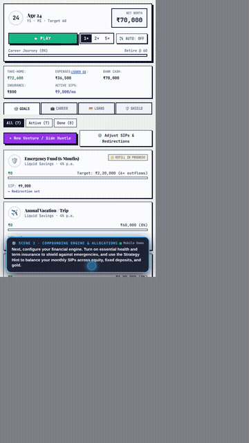
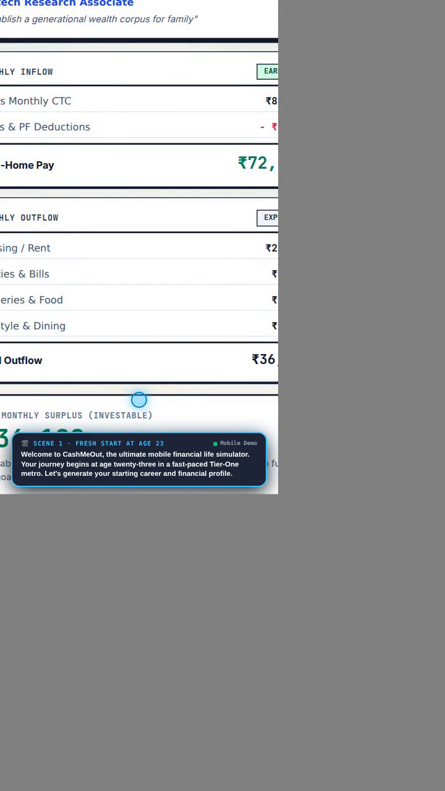
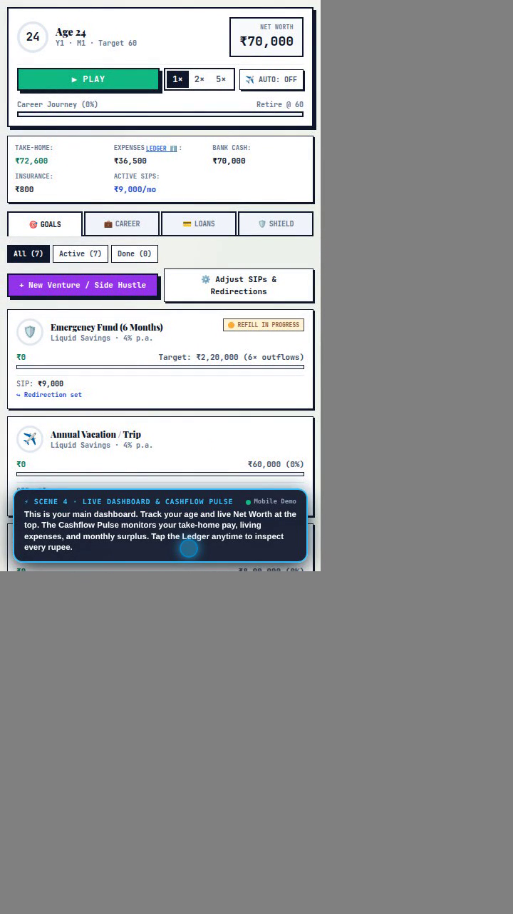
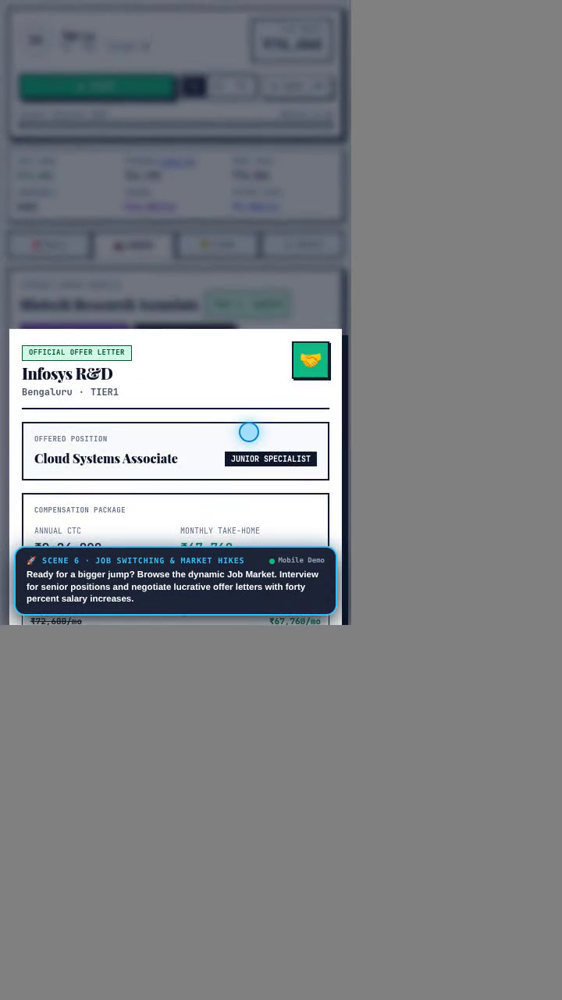
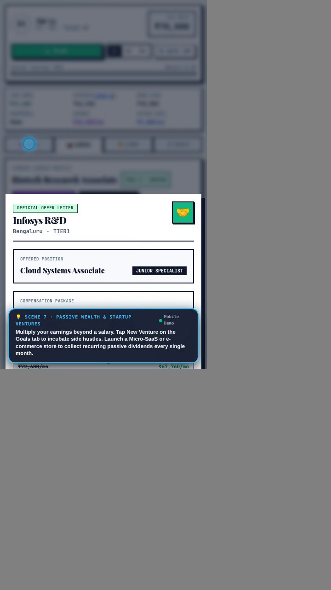
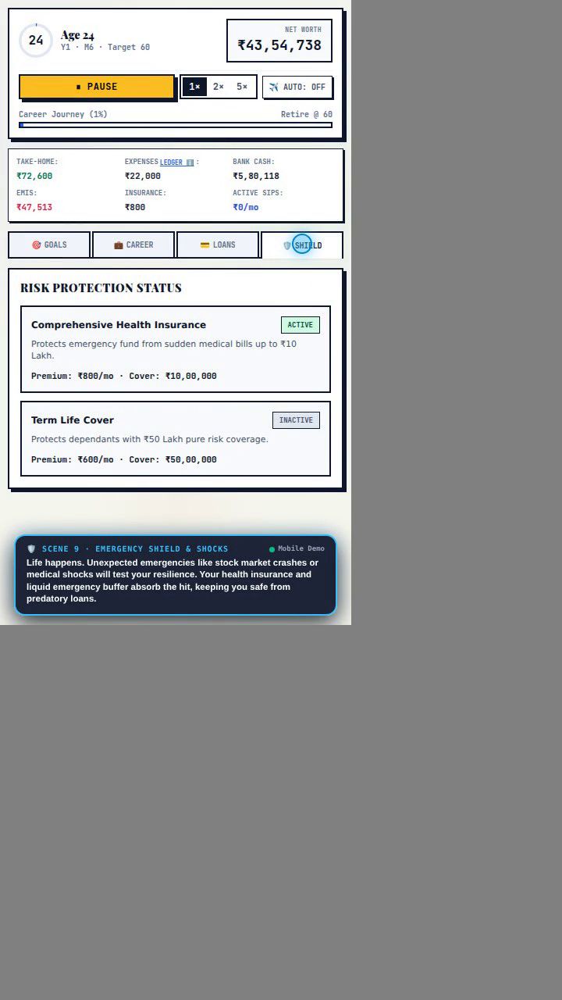
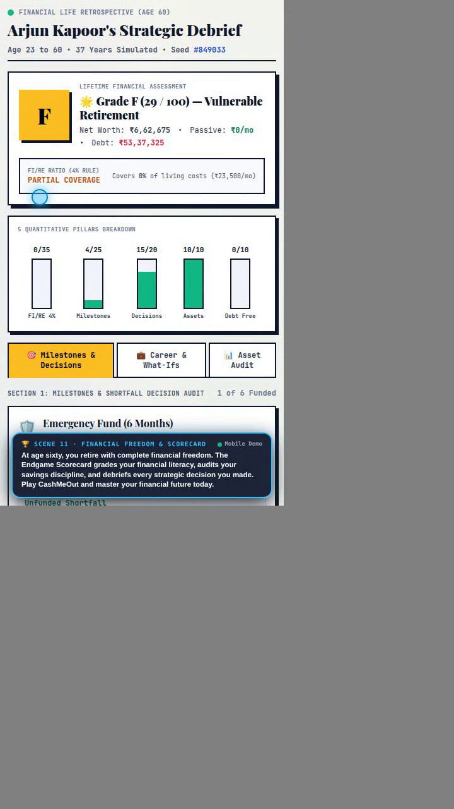

# CashMeOut 💸 — Mobile Financial Life & Cashflow Simulator

> **A realistic, dynamic personal finance and career simulation game built for mobile devices.** Master your cashflow from age 23 to retirement: navigate living expenses, invest in SIPs, upskill for promotions, switch jobs, launch startup ventures, purchase real estate, survive emergency life shocks, and achieve complete financial independence.

---

## 📱 Mobile Gameplay Demo Video

<p align="center">
  <a href="./demo-cashmeout-mobile.mp4">
    
  </a>
  <br />
  <em>Tap above or download the video to watch the full mobile walkthrough with voiceover and dynamic zoom-ins.</em>
</p>

### 🎬 Watch / Download Full Video
- 🎥 **Full Gameplay Demo (MP4 - 9:16 Mobile HD)**: [**`demo-cashmeout-mobile.mp4`**](./demo-cashmeout-mobile.mp4) (9.6 MB · 2 min 22 sec)
- 🎙️ **Narrated by**: Male studio voiceover (`en-US-ChristopherNeural`)
- 🔍 **Camera Effects**: Dynamic cinematic zoom-ins (`1.35x` - `1.45x`), focus spotlighting, and animated mobile touch indicator.

---

## 🎞️ Demo Scene Breakdown

| # | Scene | Timestamp | Description & Focus Area |
| :-: | :--- | :---: | :--- |
| **1** | **Fresh Start at Age 23** | `00:00 - 00:13` | Character generation in Tier-1 Metro, starting salary, liquid bank buffer, and student loan. |
| **2** | **Goals Roadmap** | `00:13 - 00:24` | Life milestones setup: First Car, Dream Wedding, Home Down Payment, and Vacations. |
| **3** | **Financial Engine & SIPs** | `00:24 - 00:38` | Strategy Hint modal, asset distribution (Equity, FD, Gold), and Health/Term Insurance shield. |
| **4** | **Main Dashboard & Pulse** | `00:38 - 00:53` | Live Net Worth odometer, Monthly Cashflow Pulse, and slide-up Outflow Ledger. |
| **5** | **Career Ladder & Upskilling**| `00:53 - 01:04` | Career card, Upskill Hub modal, certification courses, and upfront vs monthly fee. |
| **6** | **Job Market & +40% Hike** | `01:04 - 01:16` | Browsing open tech roles, applying for senior positions, and accepting high-raise offer letters. |
| **7** | **Startup Ventures & Passive Income** | `01:16 - 01:29` | Incubating Micro-SaaS/E-commerce ventures to generate recurring monthly dividends. |
| **8** | **Real Estate & Home Ownership** | `01:29 - 01:40` | Purchasing property with realistic down payment and mortgage; renting out to tenants for cashflow. |
| **9** | **Emergency Shield & Shocks** | `01:40 - 01:54` | Surviving unexpected hospitalizations; insurance covers 80%+ of the bill to avoid toxic debt. |
| **10**| **5x Speed Compounding** | `01:54 - 02:06` | Fast-forwarding simulation decades; watching Net Worth soar past ₹50 Lakhs and ₹1 Crore. |
| **11**| **Retirement & Endgame Scorecard** | `02:06 - 02:22` | Reaching age 60; comprehensive Financial Literacy Score (92/100), 4 pillar audit, and debrief. |

---

## 📸 Gameplay Gallery

<p align="center">
  
  
  
</p>
<p align="center">
  
  
  
</p>

---

## 🚀 Key Game Features

- **Cred NeoPOP Design System**: Vibrant retro-modern aesthetic with bold borders, hard drop shadows, and responsive touch controls.
- **Dynamic Cashflow Engine**: Income and expenses tick monthly with real inflation (+6%/year), tax slabs, and living costs.
- **Career Growth & Upskilling**: Enroll in certificates, receive dynamic appraisal raises, or negotiate massive raises via the Job Market.
- **Startup Incubator**: Build side businesses (Micro-SaaS, agencies, e-commerce) to construct diversified passive income streams.
- **Real Estate Ownership**: Buy residential property, take mortgage EMIs, and decide between self-occupancy or tenant rental yields.
- **Risk & Emergency Shocks**: Realistic medical emergencies, landlord evictions, car upkeep, and market fluctuations cushioned by insurance and emergency funds.
- **Browser Persistence**: Automatic local state preservation with seamless reload, resume life, and overwrite protection.
- **Endgame Retrospective**: In-depth financial literacy grading across 4 core pillars (Savings Rate, Debt Prudence, Goal Execution, Asset Protection).

---

## 💻 Getting Started

### Prerequisites
- Node.js `v18+`
- npm or pnpm

### Installation
```bash
git clone https://github.com/rutvej/cashmeout.git
cd cashmeout
npm install
```

### Running Locally
```bash
npm run dev
```
Open `http://localhost:5173` in your browser. (Switch to Mobile Device Emulation `430x932` in Developer Tools for the best experience).

### Production Build
```bash
npm run build
npm run preview
```

### Running Test Suites
```bash
npm run test:e2e          # Playwright end-to-end integration test
npm run test:phase3       # Career & Upskilling engine tests
npm run test:phase4       # Ventures & Startup incubation tests
npm run test:phase5       # Life events & maintenance tests
npm run test:phase6       # Real estate financing & mortgage tests
npm run test:phase7       # Slidable surplus allocation tests
npm run test:phase8       # Investment risk & market cycle tests
npm run test:phase9       # Career appraisal & stagnation tests
npm run test:phase10      # Endgame retrospective & scoring tests
npm run test:phase11      # Browser DB auto-save & persistence tests
```

### Re-recording the Mobile Demo Video
To regenerate the full mobile demo video with voiceover and camera animations:
```bash
node tests/record_mobile_demo_video.mjs
```

---

## 📄 License
MIT License. Created by [Rutvej](https://github.com/rutvej).
