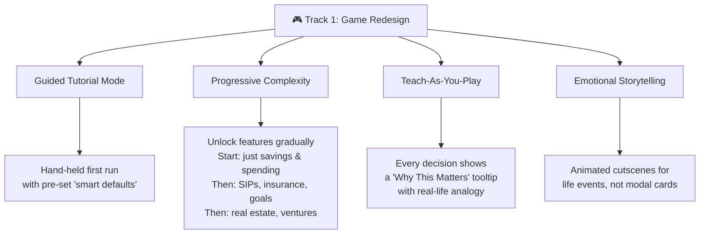
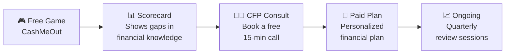

# CashMeOut — Strategy for 22+ Year Olds & CFP Business Model

> [!IMPORTANT]
> **Your core problem**: CashMeOut is a *great* financial literacy engine, but right now it plays like a complex simulation dashboard — not a game that a 22-year-old who's never heard of "SIP" or "asset allocation" would voluntarily pick up and learn from. The gap isn't in the financial logic — it's in the **onboarding, storytelling, and guided experience**.

---

## 🎯 The Real Problem: Why 22-Year-Olds Bounce

After reviewing your full codebase (~5,500 lines of core engine + UI), the previous bug audits, gameplay reports, and your demo video, here's the honest diagnosis:

### What's Working ✅
| Strength | Evidence |
|----------|----------|
| Financial engine is deep & realistic | Compound interest, inflation, tax slabs, insurance, SIPs, waterfall redirects, real estate |
| Seed-based deterministic replay | Shareable runs, competitive element built-in |
| Career system is rich | Upskilling, job market, appraisals, stagnation penalties, ventures |
| Mobile-first design | Cred NeoPOP aesthetic, 430×932 optimized |
| Endgame retrospective | 5-pillar scoring, strategy debrief |

### What's Broken for the Target Audience 🚫

| Problem | Why It Kills Engagement for 22-Year-Olds |
|---------|------------------------------------------|
| **Cold start with jargon** | First screen dumps: SIP allocation %, Equity MF vs FD vs Gold ratios, "waterfall cascade" — a 22-year-old who doesn't know what an SIP *is* just closes the tab |
| **No teaching moment** | The game *simulates* financial life but never *explains* why something matters. It assumes literacy that it's supposed to *build* |
| **Too many decisions at once** | Financial Setup Screen asks for 6+ instrument allocations, insurance toggles, goal redirections — all before the game even starts |
| **Monthly ticks are invisible** | Numbers change silently at 5x speed. No one learns from watching digits fly by. The "aha moment" never happens |
| **No emotional hooks** | Events appear as modal cards with numbers. A ₹1.8L medical shock should feel *devastating*, not just be a popup |
| **Scorecard is post-mortem** | You only discover what you did wrong at age 60 — there's no mid-game coaching |
| **No guided first run** | No tutorial, no hand-holding, no "here's what a smart person would do and why" |

---

## 🏗️ The Fix: Two-Track Redesign

### Track 1: Make the Game Accessible (Product Changes)



#### 1. **Guided Tutorial Mode** (Priority: 🔴 Critical)

Replace the current cold-start with a **narrative first run**:

```
CURRENT FLOW:
  Landing → Character Spawn → Goal Setup → Financial Setup → GO!
  (all jargon, all at once, zero context)

NEW FLOW:
  Landing → "Meet Priya, age 22. She just got her first job."
  → Month 1: "Your salary is ₹45,000. Rent is ₹15,000. Food is ₹7,000..."
  → "You have ₹23,000 left. What should you do with it?"
     [A] Spend it all (YOLO)
     [B] Save some for emergencies
     [C] I don't know, help me
  
  → If B or C: "Smart! Let's put ₹10,000 in a savings account.
     This is called an 'Emergency Fund'. Here's why..."
  
  → Month 3: "Oh no, your bike broke down. Repair cost: ₹8,000."
     → If they saved: "Good thing you saved! You can pay from your fund."
     → If they didn't: "You have to borrow from a friend (loan). 
        This will cost you ₹500/month extra in interest."
  
  → "See? That's why saving matters. NOW let's set up your financial plan..."
```

This is the **single most important change**. A 22-year-old needs to *feel* the consequence of a decision before being asked to make a complex allocation.

#### 2. **Progressive Complexity Unlock** (Priority: 🔴 Critical)

Don't show everything at once. Unlock features as the player ages:

| Age Range | Unlocked Features | Teaching Moment |
|-----------|-------------------|-----------------|
| 22-24 | Savings, basic expenses, emergency fund | "Why you need a buffer" |
| 25-27 | SIPs (just 2 options: safe vs growth), first goal | "What is investing and why" |
| 28-30 | Insurance, marriage event, more instruments | "Protecting what you've built" |
| 30-35 | Job market, upskilling, career growth | "Your salary is your biggest asset" |
| 35-40 | Real estate, mortgages, EMI management | "Good debt vs bad debt" |
| 40-50 | Ventures, passive income, advanced portfolio | "Making money work for you" |
| 50-60 | Retirement planning, debt-free finish | "The endgame" |

#### 3. **"Why This Matters" Tooltips** (Priority: 🟠 High)

Every financial decision should have a toggle to show the real-life context:

```
┌──────────────────────────────────────┐
│  Allocate to Equity Mutual Funds?    │
│  ████████████████░░░░ 40%            │
│                                      │
│  💡 Real Talk:                       │
│  "This is like buying tiny pieces    │
│  of 500 companies. It grows ~12%/yr  │
│  but can drop 30% in a crash.        │
│  If you're 23, you have 37 years     │
│  to recover — that's why young       │
│  people should put more here."       │
│                                      │
│  📊 If you invest ₹5,000/mo here    │
│  for 20 years at 12%: ₹49.9 Lakhs   │
│  (You only put in ₹12 Lakhs!)       │
└──────────────────────────────────────┘
```

#### 4. **Mid-Game CFP Coach** (Priority: 🟠 High — *this is your business hook*)

Add an AI/rule-based "coach" character that appears periodically:

```
🧑‍💼 "Hey! I noticed your EMI-to-income ratio just crossed 50%.
     In real life, banks won't even give you more loans at this point.
     
     A Certified Financial Planner would tell you to:
     1. Stop taking new loans
     2. Prepay the highest-interest one first
     3. Keep EMIs under 40% of income
     
     Want to talk to a real CFP? [Connect with our partner]"
```

This is where **your CFP friend's expertise becomes the product**.

---

### Track 2: The Business Model with Your CFP Friend



#### Business Model Options

| Model | How It Works | Revenue | Effort |
|-------|-------------|---------|--------|
| **A. Lead-Gen Funnel** | Game is free. Scorecard shows "You scored 45/100 in Debt Discipline — a CFP can fix this." → Book call with your CFP friend | CFP charges ₹5,000–₹15,000 per plan. You get 30-50% referral fee | Low — just add CTA buttons |
| **B. Workshop Tool** | CFP friend runs workshops for corporates / colleges. CashMeOut is the "homework" — play the game, then discuss strategy in the workshop | ₹25,000–₹1,00,000 per workshop (corporate). ₹2,000–₹5,000 per student (college) | Medium — need workshop deck + game customization |
| **C. Freemium App** | Free: 1 playthrough. Paid (₹199/mo): unlimited seeds, detailed analytics, "optimal play" comparison, coach mode | Subscription revenue | High — need app store presence, payment integration |
| **D. White-Label for CFPs** | License CashMeOut to other CFPs/financial advisors as their client engagement tool | ₹5,000–₹20,000/month per advisor license | High — need multi-tenant setup |

> [!TIP]
> **Recommended starting point: Model B (Workshop Tool) + Model A (Lead-Gen)**
> 
> This is the fastest path to revenue with the lowest technical effort:
> 1. Your CFP friend already has a network of potential clients
> 2. The game becomes a "financial health check" that naturally leads to "now let me help you fix this in real life"
> 3. You can start running workshops in colleges/corporates within weeks
> 4. Zero app store friction — it's a web game, just share the link

---

## 📋 Concrete Action Plan

### Phase 1: Fix the Game for 22-Year-Olds (2-3 weeks)

| # | Task | Impact | Effort |
|---|------|--------|--------|
| 1 | **Build Tutorial/Story Mode** — narrative first run with Priya/Arjun character, teaches concepts through consequences | 🔴 Critical | 5-7 days |
| 2 | **Progressive unlock system** — don't show SIP allocation to someone who hasn't learned what saving is | 🔴 Critical | 3-4 days |
| 3 | **Fix the 15 bugs** from previous audit (especially free money exploit, broken scoring, FI/RE cap) | 🔴 Critical | 2-3 days |
| 4 | **Add "Why This Matters" tooltips** to every financial decision | 🟠 High | 2-3 days |
| 5 | **Slow down the early game** — first 12 months should play month-by-month with explanations, not blur past at 5x | 🟠 High | 1-2 days |

### Phase 2: Add CFP Business Hooks (1-2 weeks)

| # | Task | Impact | Effort |
|---|------|--------|--------|
| 6 | **In-game CFP Coach character** — rule-based tips that mirror what your CFP friend would actually say | 🔴 Critical | 3-4 days |
| 7 | **Enhanced scorecard with real-life mapping** — "Your game score suggests you need to work on X, Y, Z. Here's what that means IRL" | 🟠 High | 2-3 days |
| 8 | **"Talk to a Real CFP" CTA** — on scorecard + after crisis events + in coach tips | 🟠 High | 1 day |
| 9 | **Workshop mode** — facilitator can set the seed so all workshop participants play the same scenario | 🟡 Medium | 1-2 days |
| 10 | **Exportable report** — "Your CashMeOut Financial Health Report" PDF that the player can take to the CFP consultation | 🟡 Medium | 2-3 days |

### Phase 3: Polish & Launch (1-2 weeks)

| # | Task | Impact | Effort |
|---|------|--------|--------|
| 11 | **Animated event cutscenes** (from previous redesign plan) | 🟡 Medium | 3-5 days |
| 12 | **Social sharing** with seed + score | 🟡 Medium | 1-2 days |
| 13 | **Landing page for the business** — "Financial Literacy, Gamified" — targeting corporates and colleges | 🟠 High | 2-3 days |
| 14 | **First 3 pilot workshops** with your CFP friend | 🔴 Critical | 1-2 weeks |

---

## 💡 The Big Insight for Your CFP Partnership

The game isn't the product. **The game is the hook.**

```
The actual business:
┌────────────────────────────────────────────────────────────┐
│                                                            │
│   🎮 Game creates awareness    → "I don't know this stuff" │
│   📊 Scorecard creates urgency → "I'm bad at this"        │
│   🧑‍💼 CFP creates trust       → "This person can help me" │
│   💼 Plan creates revenue      → "Take my money"          │
│                                                            │
└────────────────────────────────────────────────────────────┘
```

Your CFP friend's value isn't just financial planning — it's **translating game lessons into real life**:

- "Remember in the game when you didn't have insurance and got hit with a ₹1.8L hospital bill? Let's make sure that doesn't happen to *you*."
- "Your game character's EMI ratio was 60%. Yours right now is 52%. Let's fix that."
- "In CashMeOut, the waterfall strategy got you to ₹1.45 Crore. Let me set that up for your *actual* investments."

---

## ❓ Decisions You Need to Make

1. **Which business model to start with?** (I recommend B + A: workshops + lead-gen)

2. **Tutorial character**: Should the guided mode use:
   - (a) The player's randomly generated character (current system)
   - (b) A fixed "Priya" or "Arjun" tutorial character that everyone plays first

3. **CFP integration depth**: 
   - (a) Just a "Book a Call" link on the scorecard (simple)
   - (b) Full in-game coach with your CFP friend's actual advice framework (deeper)
   - (c) Both — coach in-game + booking link post-game

4. **Target audience priority**:
   - (a) College students (22-year-olds, lower ticket but volume play)
   - (b) Young professionals (25-30, higher willingness to pay)
   - (c) Corporate workshops (HR/L&D budgets, highest ticket)

5. **Want me to start building the Tutorial Mode right now?**
