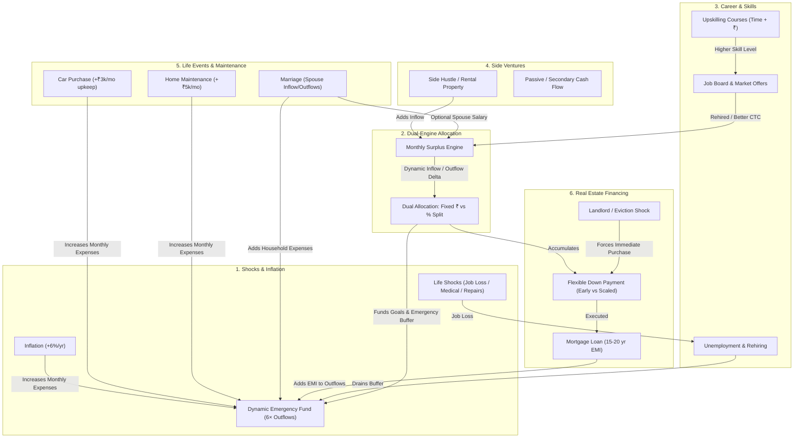
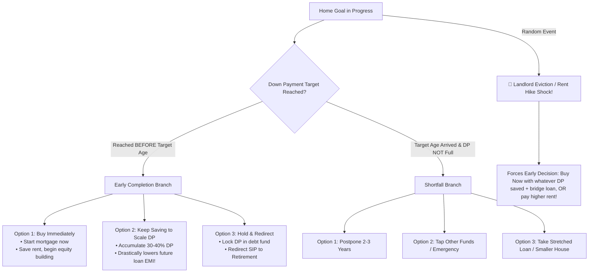

# Cashflow Game: Expansion Specification & Mechanics Architecture

## Executive Summary
This specification builds upon the established Cred NeoPOP engine to transform the simulation from a linear savings tracker into an authentic, dynamic personal finance and life strategy simulator.

---

## 1. System Interconnections & Overlap Map

---

## 2. Detailed Specifications by Point

---

### Point 1: Difficulties, Shocks, Inflation & Dynamic Emergency Buffer

#### A. Core Concepts & Math
1. **Annual Inflation Engine:**
   - Every 12 months (month % 12 === 0), living expenses inflate by an annual rate $i \in [5.0\%, 7.0\%]$ (default 6.0%):
     $$\text{fixedExpenses}_{t+1} = \text{fixedExpenses}_t \times (1 + i)$$
2. **Dynamic Emergency Fund Target:**
   - In real financial planning, an emergency fund is NOT a static ₹3,00,000; it is **6 months of total ongoing monthly outflows** (living expenses + all active loan EMIs + insurance premiums + property/car maintenance):
     $$\text{targetAmount}_{\text{emergency}} = 6 \times \text{totalMonthlyOutflow}$$
   - Whenever monthly outflows increase (due to inflation, new car maintenance, home mortgage EMI, marriage, or rent hikes), `targetAmount` automatically recalibrates upward.
   - If `currentAmount < targetAmount`, status transitions to `refill_needed` and the waterfall recalls its SIP!
3. **Difficulty Shock Events:**
   - **Job Loss / Layoff:**
     - Take-home salary drops to ₹0 for $D \in [2, 5]$ months (or 1-month severance paid as lump sum).
     - Character must rely on liquid cash + Emergency Fund to survive while searching for jobs (see Point 3).
   - **Hospitalization / Critical Illness:**
     - Severe medical expense ($\text{₹1.5L to ₹4.0L}$).
     - If **Health Insurance** is active: Player pays only deductible (₹5,000).
     - If uninsured: Direct deduction from Emergency Fund / Liquid Cash. If depleted, creates emergency personal loan at 14% p.a.!
   - **Major Appliance / Home Breakdown:**
     - Unexpected repair shock ($\text{₹25,000 to ₹75,000}$) directly testing liquid reserves.

---

### Point 2: Dual Surplus Allocation (₹ Amount vs % Percentage) & Auto-Split

#### A. Problem & Opportunity
When a salary hike, loan payoff, or side-income increase occurs, players currently face repetitive manual slider adjustments.

#### B. Allocation Models
1. **Mode A: Fixed Rupee Allocation (`fixed_amount`)**
   - User assigns explicit ₹ per goal (e.g. ₹5,000 to Emergency, ₹10,000 to Vacation).
   - Remaining surplus goes to bank liquid cash.
2. **Mode B: Percentage-Based Allocation (`percentage_split`)**
   - Each active goal receives a weight:
     $$\sum_{g \in \text{goals}} w_g = 100\%$$
   - Goal SIP is calculated dynamically each month:
     $$\text{SIP}_g = \text{MonthlySurplus} \times w_g$$
3. **Auto-Split on Salary Appraisal / Inflow Delta:**
   - When a hike occurs (e.g. $+\text{₹8,500/mo}$), the player has 3 one-click actions:
     1. **"Auto-Split by Current %"**: Proportionally boosts all active goal SIPs according to their weight.
     2. **"100% to Retirement / Wealth"**: Directs the entire delta to long-term compounding.
     3. **"Custom Adjust"**: Opens the Cred NeoPOP allocation sheet to tweak amounts or percentages.

---

### Point 3: Career Progression, Upskilling Courses & Dynamic Job Market

#### A. Career Ladder & Skill Level
- Every character has:
  - `yearsOfExperience`: Increments by +1 every 12 months.
  - `skillLevel`: Integer scale 1 to 5 (Entry, Mid, Senior, Lead, Executive/Architect).
  - `currentField`: Science, Tech, Finance, Arts, Business.

#### B. Upskilling Courses (Skill Development)
- User can open the **Career Hub** and enroll in professional courses/certifications:
  - *Short Certification:* Cost: ₹35,000 | Duration: 3 months | Grants +0.5 Skill Points.
  - *Executive Master / Advanced Diploma:* Cost: ₹1,50,000 | Duration: 9 months | Grants +1.5 Skill Points.
- During course tenure, the monthly course fee is deducted from cash/surplus.

#### C. The Job Market Board (`Job Offers`)
- Under the **Career Tab**, available jobs are dynamically generated:
  - Requirements: `minExperience`, `minSkillLevel`.
  - Compensation: Higher base salary (e.g. $+25\%$ to $+60\%$ jump), but potentially different city or higher expectations.
  - Application outcome: Instant or 1-month interview process.
- **Job Loss Integration:**
  - If a player loses their job, they can immediately apply to available openings matching their current tier. Higher skill level and experience drastically reduce the time to get hired!

---

### Point 4: Extra / Opt-in Goals: Side Businesses & Cash-Flow Assets

#### A. Beyond Plain Corpus Goals
Currently, goals only compound money for a future payout. Opt-in goals introduce **Assets that generate recurring cash flow**.

#### B. Asset Types
1. **Digital / Side Hustle Business:**
   - Seed Capital Target: ₹2,00,000 to ₹5,00,000.
   - Once funded: Launches the business!
   - Generates recurring net income: $+\text{₹8,000 to ₹25,000/mo}$ (variable, +8-12% p.a. yield) added to monthly take-home.
2. **Commercial / Second Rental Property:**
   - Down Payment: ₹8,00,000.
   - Mortgage: Remaining on 15-year EMI.
   - Rental Income: $+\text{₹22,000/mo}$ incoming, offsetting EMI and providing net equity accumulation and tax benefits.
3. User can opt into these opportunities at any point from a "+ New Venture / Extra Goal" menu.

---

### Point 5: Life Event Reality: Recurring Maintenance & Marriage Dynamics

#### A. Buying a Car: Upkeep & Depreciation
- Purchasing a car adds **recurring monthly vehicle maintenance & insurance** directly to `character.totalFixedExpenses`:
  $$\Delta \text{fixedExpenses}_{\text{car}} = +\text{₹3,500/mo}$$
- This increases total outflows, slightly reducing surplus and appropriately inflating the required Emergency Fund buffer.

#### B. Marriage & Spouse Finances
- When the Wedding milestone is reached:
  - One-time wedding expense is disbursed.
  - **Spouse Profile Rolled:**
    - `hasIncome`: 65% probability of dual-income household.
    - `monthlyTakeHome`: e.g. ₹35,000 – ₹70,000/mo added to household inflows.
    - `householdExpenseIncrease`: +40% to +60% increase in baseline living costs (larger apartment, groceries, utilities).
  - Net impact: If spouse works, surplus increases; if single-earner family, surplus tightens!

#### C. Buying a Home: Upkeep & Taxes
- Adding homeownership introduces **property maintenance and taxes**:
  $$\Delta \text{fixedExpenses}_{\text{home}} = +\text{₹5,000 to ₹8,000/mo}$$
  added to fixed expenses upon moving in.

---

### Point 6: Realistic Real Estate Mechanics: Down Payment vs Mortgage & Early Buy

#### A. The Real-Estate Architecture
- **Property Total Cost:** e.g. ₹75,00,000.
- **Down Payment Goal (20%):** ₹15,00,000.
- **Mortgage (80%):** ₹60,00,000 loan over 180–240 months at 8.5% p.a.

#### B. Decision Scenarios

1. **Early Completion (e.g. saved ₹15L by Age 29, planned for 34):**
   - **Option 1: Buy Immediately (Accelerate):** Purchase property immediately, take mortgage now, transition from renting to owning.
   - **Option 2: Overfund Down Payment (Smart Buyer):** Keep contributing to the home fund. At age 34, user puts down ₹25L instead of ₹15L, reducing loan from ₹60L to ₹50L, saving lakhs in interest!
   - **Option 3: Lock & Wait:** Stop home SIP, preserve ₹15L in safe liquid instruments, and let waterfall cascade surplus to investments until age 34.

2. **Underfunded at Target Age:**
   - Postpone, tap bank/emergency funds, or scale down property budget.

3. **Urgent Housing Shocks ("Spicy Things Up"):**
   - *Landlord Eviction:* Landlord decides to sell the rented flat. Player has 30 days to either move (high brokerage + moving fees) or execute an emergency home purchase if down payment is >70% ready!

---

## 3. Recommended Phased Implementation Plan

| Phase | Core Focus | Files Involved |
|---|---|---|
| **Phase 1** | **Inflation & Dynamic Emergency Fund & Difficulty Shocks** | `simulationEngine.js`, `characterGenerator.js`, `store.js` |
| **Phase 2** | **Dual-Engine Allocation (% and ₹) & Auto-Split on Hike** | `compoundingEngine.js`, `FinancialSetupScreen.jsx`, `RaiseModal.jsx` |
| **Phase 3** | **Car Maintenance, Marriage Profile & Home Maintenance Outflows** | `simulationEngine.js`, `MilestoneModal.jsx`, `characterGenerator.js` |
| **Phase 4** | **Comprehensive Home Buying Engine (Early Buy / Scaled DP / Mortgage)** | `MilestoneModal.jsx`, `store.js`, `simulationEngine.js` |
| **Phase 5** | **Career Ladder, Upskilling Courses & Interactive Job Board** | `MainGameScreen.jsx` (Career Tab), new `CareerHubModal.jsx` |
| **Phase 6** | **Extra Opt-In Goals (Side Businesses & Cash-Flow Assets)** | `store.js`, `goalsGenerator.js`, `MainGameScreen.jsx` |
