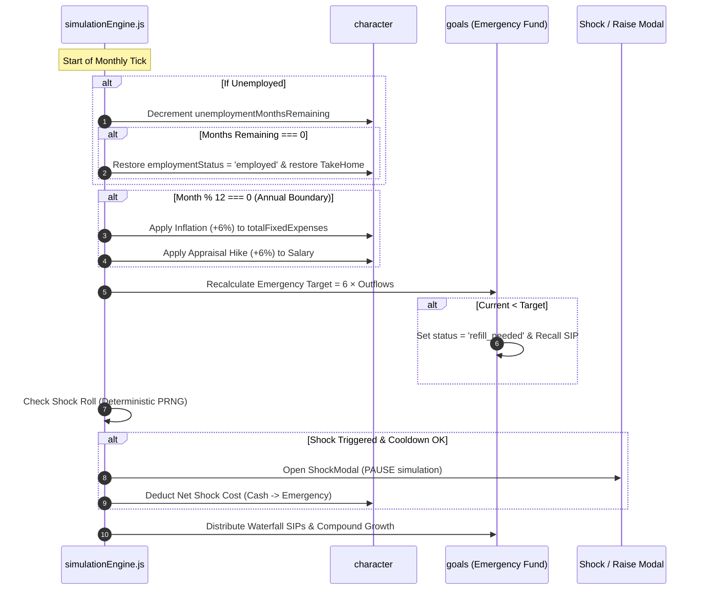

# Phase 1 Technical Specification: Shocks, Inflation & Dynamic Emergency Buffer

## 1. Overview & Objective
Phase 1 transforms the economic environment from a risk-free passive compounding loop into a realistic, resilient simulation. It implements:
1. **Dynamic Emergency Fund Target:** Recalibrated continuously as $6 \times \text{totalMonthlyOutflow}$.
2. **Annual Inflation Engine:** Living expenses inflate by $+5.0\%$ to $+7.0\%$ annually at every 12-month boundary.
3. **Difficulty Shock Events:** Deterministic, seed-governed life events (Layoffs/Job Loss, Medical Emergencies, Repair Bills) that pressure-test insurance coverage and emergency buffers.

---

## 2. Mathematical Formulations & State Rules

### A. Dynamic Emergency Fund Recalibration
In current gameplay, the Emergency Fund has a static target (e.g., ₹3,00,000). In real financial planning, an emergency fund must equal **6 months of ongoing baseline commitments**.

$$\text{MonthlyOutflow}_t = \text{totalFixedExpenses}_t + \sum \text{loanEMI}_t + \sum \text{insurancePremiums}_t + \text{maintenanceCosts}_t$$

$$\text{Target}_{\text{emergency}, t} = \text{Math.round}\left(6 \times \text{MonthlyOutflow}_t\right)$$

#### Buffer State Machine & Waterfall Trigger
```
                          ┌──────────────────────────┐
                          │ Total Outflows Increase  │
                          │ (Inflation, EMI, Upkeep) │
                          └────────────┬─────────────┘
                                       │
                                       ▼
                     [ Target Re-calculated: Target(new) ]
                                       │
              ┌────────────────────────┴────────────────────────┐
              ▼                                                 ▼
    currentAmount >= Target                           currentAmount < Target
              │                                                 │
      [ BUFFER FULL ]                                   [ REFILL NEEDED ]
   • status = 'buffer_full'                          • status = 'refill_needed'
   • Waterfall overflows forward                     • Instant Waterfall Recall:
     to redirectGoalId                                 SIP recalled from redirectGoalId
   • Interest swept to Liquid Cash                   • 100% of base SIP returns to Buffer
```

---

### B. Annual Inflation Engine
- **Trigger:** Checked every 12 months (`nextMonthIndex % 12 === 0` and `nextMonthIndex > 0`).
- **Inflation Rate ($i$):** Deterministic roll between $5.0\%$ and $7.0\%$ per annum (default average $6.0\%$).
- **Impact on Fixed Expenses:**
  $$\text{totalFixedExpenses}_{t+1} = \text{Math.round}\left(\frac{\text{totalFixedExpenses}_t \times (1 + i)}{100}\right) \times 100$$
- **Cascading Economic Effects:**
  1. $\text{MonthlyOutflow} \uparrow$
  2. $\text{MonthlySurplus} \downarrow$ ($\text{TakeHome} - \text{MonthlyOutflow}$)
  3. $\text{EmergencyFund Target} \uparrow$ ($6 \times \text{MonthlyOutflow}$)
  4. If appraisal hike ($\approx 6\%$) matches inflation ($\approx 6\%$), net real surplus remains stable. If raise is skipped or lower, real cash flow tightens!

---

### C. Difficulty Shock Events Engine
Shocks are rolled deterministically using the player's seed to ensure reproducible runs.

#### 1. Cooldown & Pacing Rules
- **No shocks during Year 1 (Months 1–12):** Gives the player initial breathing room to set up their allocations.
- **Minimum Cooldown:** At least **18 months** between major shock events.
- **Annual Event Roll:** Rolled once every year (e.g., Month 6 of each year) with a **35% trigger probability**.

#### 2. Event Types & Resolution Table

| Event ID | Name & Description | Cost / Financial Impact | Insurance / Buffer Defense |
|---|---|---|---|
| `shock_medical` | **Hospitalization / Critical Illness**<br/>Sudden surgery or acute illness requiring inpatient hospital stay. | Gross bill: **₹1,80,000 to ₹3,50,000** | **With Health Insurance:** Character pays only the deductible (**₹5,000**). Policy covers remaining 100%.<br/>**Without Insurance:** Full bill deducted from Liquid Cash $\to$ Emergency Fund. If depleted, creates high-interest medical debt. |
| `shock_job_loss` | **Company Restructuring / Layoff**<br/>Sudden job termination due to market conditions. | Monthly Salary drops to **₹0/mo** for **2 to 4 months**.<br/>Severance: 1 month salary credited upfront. | Outflows continue monthly! Liquid cash & Emergency Fund burn month-by-month until character finds a new job. |
| `shock_home_repair` | **Critical Home / Vehicle Breakdown**<br/>Severe plumbing burst, structural seepage, or transmission failure. | Fixed repair invoice: **₹35,000 to ₹75,000** | Deducted from Liquid Cash. If insufficient, drawn from Emergency Fund. |

---

## 3. Detailed Data Schemas

### A. Extended Character State (`character`)
```typescript
export interface CharacterState {
  // Existing fields...
  monthlyTakeHome: number;
  totalFixedExpenses: number;
  liquidCash: number;
  
  // Phase 1 Additions:
  employmentStatus: 'employed' | 'unemployed';
  unemploymentMonthsRemaining: number;
  preLayoffTakeHome?: number;
  lastShockMonthIndex: number;
}
```

### B. Extended Goal Item (`goal_emergency`)
```typescript
export interface EmergencyGoalItem {
  id: 'goal_emergency';
  name: 'Emergency Fund';
  kind: 'recurring';
  category: 'safety';
  targetMonthsMultiplier: 6;      // Always 6x monthly outflows
  targetAmount: number;            // Dynamically computed: 6 * totalMonthlyOutflow
  currentAmount: number;
  baseMonthlySIP: number;
  effectiveMonthlySIP: number;
  redirectGoalId: string;
  status: 'buffer_full' | 'refill_needed' | 'in_progress';
}
```

### C. Shock Modal Payload (`simulation.activeModal`)
```typescript
export interface ShockModalData {
  type: 'shock_event';
  shockId: 'shock_medical' | 'shock_job_loss' | 'shock_home_repair';
  title: string;
  description: string;
  grossAmount: number;
  insuranceCoveredAmount: number;
  netOutflow: number;
  usedInsurance: boolean;
  unemploymentDuration?: number;
  severancePaid?: number;
  drawnFromCash: number;
  drawnFromEmergency: number;
  unfundedDeficit: number;
}
```

---

## 4. Simulation Loop Execution Flow in `tickMonthlySimulation`



---

## 5. UI & Interaction Design (Cred NeoPOP Light Theme)

### A. Dynamic Emergency Fund Card
- **Target Label:** Shows `"Target: ₹3,12,000 (6× outflows)"` instead of a static number.
- **Dynamic Badge:**
  - 🟢 `SHIELD INTACT (100%)` when `currentAmount >= targetAmount`.
  - 🟠 `REFILL IN PROGRESS` with an amber pulse when expenses expanded the target.

### B. Shock Event Modal (`ShockModal.jsx`)
- **Header:** NeoPOP warning container with bold icons (🏥 Medical Shock, ⚡ Job Loss, 🔧 Major Repair).
- **Damage Assessment:**
  - Gross Invoice vs. Insurance Protection breakdown.
  - Clear line item: *"Health insurance saved you ₹2,45,000! You only paid the ₹5,000 deductible."*
- **Emergency Fund Status Bar:** Shows before vs. after buffer level.
- **Action CTA:**
  - Primary: `"Acknowledge & Mobilize Funds ➔"` (Resumes simulation).
  - Secondary: `"Review Allocations"` (Opens Financial Setup sheet).

---

## 6. Implementation Checklist & Verification Matrix

1. **`compoundingEngine.js`:**
   - Update [`calculateEffectiveSIPs`](file:///home/rutvej/Desktop/cashflow-game/src/engine/compoundingEngine.js#L35) to handle dynamic target auto-recalls seamlessly when `currentAmount < targetAmount`.
2. **`simulationEngine.js`:**
   - Implement `applyAnnualInflation(character, inflationRate)`.
   - Implement dynamic recalculation for `goal_emergency.targetAmount = 6 * totalMonthlyOutflow`.
   - Implement deterministic `rollShockEvent(seed, monthIndex, character, insurance)`.
   - Handle unemployment cash burn & rehire sequence.
3. **`ShockModal.jsx`:**
   - Build high-contrast Cred NeoPOP alert modal.
4. **`MainGameScreen.jsx`:**
   - Add status pill on top bar if `character.employmentStatus === 'unemployed'` (e.g. `⚠️ Layoff: 2 mos left`).
   - Display dynamic multiplier indicator on the Emergency Fund card.
