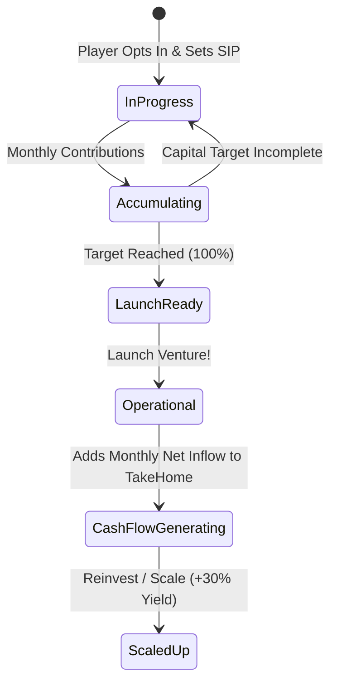

# Phase 4 Technical Specification: Extra Opt-In Goals & Cash-Flow Ventures

## 1. Overview & Objective
Currently, goals only function as capital sinks (accumulating funds to spend or compound). Phase 4 introduces **Income-Generating Ventures & Extra Goals** that players can launch voluntarily. Once funded, these ventures transition into active assets that deliver recurring monthly cash flow, expanding take-home income and altering the character's financial trajectory.

---

## 2. Venture Types & Economic Models

### A. Digital Product / SaaS / Freelance Agency
- **Seed Capital Target:** ₹2,50,000 (accumulated via goal SIP).
- **Time to Market:** Once capital hits 100%, venture officially launches.
- **Recurring Monthly Cash Inflow:**
  - Base monthly revenue: **+₹12,000 to +₹25,000/month**.
  - **Dynamic Volatility:** Monthly revenue can fluctuate by $\pm 15\%$ reflecting market demand.
- **Tax & Operating Outflow:**
  - Net profit directly added to `character.monthlyTakeHome`.

### B. Boutique Franchise / Cafe / Physical Micro-Business
- **Capital Requirement:** ₹6,00,000.
- **Financing:** Can be funded via 100% saved capital or 50% equity + 50% small business loan.
- **Cash Flow Yield:**
  - Gross monthly profit: **+₹45,000/month**.
  - Monthly operational manager expense: -₹15,000/month.
  - Net passive dividend: **+₹30,000/month**.

### C. Rental Property (Second Investment Asset)
- **Down Payment Required:** ₹10,00,000 (20% of ₹50,00,000 flat).
- **Mortgage Financed:** ₹40,00,000 over 15 years at 8.5% EMI ($\approx \text{₹39,400/mo}$).
- **Rental Inflow:** $+\text{₹28,000/month}$ rent received.
- **Equity Growth:** Property asset compounds at $6.5\%$ p.a., increasing net worth while the tenant helps pay down mortgage principal.

---

## 3. The Lifecycle of an Extra Venture Goal



---

## 4. Data Schema Extensions

```typescript
export interface VentureGoalItem {
  id: string;
  name: string;
  ventureType: 'side_hustle' | 'franchise' | 'rental_property';
  category: 'venture';
  icon: string;
  
  // Funding stage
  targetAmount: number;             // Capital needed to launch
  currentAmount: number;
  baseMonthlySIP: number;
  
  // Operational stage
  isLaunched: boolean;
  launchedAtMonthIndex?: number;
  monthlyRevenueBase: number;       // Gross income generated
  monthlyOperationalCost: number;   // Maintenance / management cost
  netMonthlyCashFlow: number;       // Added to take-home
}
```

---

## 5. UI & Interaction Design (Cred NeoPOP Light Theme)

### A. "+ New Venture" Floating Action in Goals Tab
- Clicking opens the **Venture Incubator Sheet**.
- Cards showcase initial cost, estimated monthly payout, and risk profile.

### B. Operational Venture Card
- Once 100% funded, the card transforms into an **Active Asset Card**:
  - Displays green pulse badge: `🟢 ACTIVE ASSET: +₹18,500/mo INFLOW`.
  - Monthly cash flow stats and total lifetime earnings collected.
