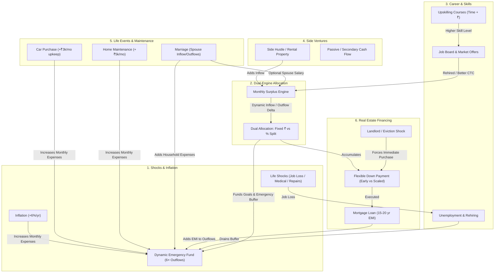

# Mechanism Spec: Game Expansion & Economic Realism (`specs/mechanics/07-game-expansion-and-realism.md`)

## 1. System Interconnections & Overlap Map

---

## 2. Detailed Specifications by Point

### Point 1: Difficulties, Shocks, Inflation & Dynamic Emergency Buffer
1. **Annual Inflation Engine:**
   - Every 12 months, living expenses inflate by $i \in [5.0\%, 7.0\%]$ (default 6.0%):
     $$\text{fixedExpenses}_{t+1} = \text{fixedExpenses}_t \times (1 + i)$$
2. **Dynamic Emergency Fund Target:**
   - Evaluated as 6 months of total ongoing outflows:
     $$\text{targetAmount}_{\text{emergency}} = 6 \times \text{totalMonthlyOutflow}$$
   - Recalculates dynamically whenever expenses, loan EMIs, or maintenance costs change.
   - If buffer falls below 100%, status toggles to `refill_needed` and waterfall redirects recall back.
3. **Difficulty Shock Events:**
   - **Job Loss / Layoff:** Salary drops to ₹0 for 2 to 5 months. Tested against liquid cash + emergency fund.
   - **Medical Hospitalization:** ₹1.5L – ₹4.0L shock. With health insurance, player only pays deductible (₹5,000).
   - **Major Appliance / Vehicle Repair:** ₹25k – ₹75k sudden liquid cash draw.

### Point 2: Dual Surplus Allocation (₹ Amount vs % Percentage) & Auto-Split
1. **Dual Modes:**
   - **Fixed ₹ Amount:** Specific rupee allocation per goal.
   - **Percentage (%) Allocation:** Goals assigned % weights summing to 100% of available monthly surplus.
2. **Auto-Split on Salary Appraisal:**
   - Players can choose:
     - "Auto-Split by Current %" (proportionally scales up all goal SIPs instantly without breaking simulation flow)
     - "Dump 100% into Retirement/Compounding"
     - "Custom Adjust" (opens Cred NeoPOP allocation sheet).

### Point 3: Career Progression, Upskilling Courses & Dynamic Job Market
1. **Career Ladder & Skills:**
   - Track `yearsOfExperience` and `skillLevel` (1 to 5).
2. **Upskilling Courses:**
   - Certifications take both capital (monthly fee or upfront) and time (e.g. 3 to 9 months).
   - Completion permanently boosts skill rating.
3. **Job Market:**
   - Career tab offers a dynamic job board with higher salary tiers.
   - Requires minimum experience and skill tier to interview.
   - If laid off, job board acts as the lifeline for getting rehired.

### Point 4: Extra / Opt-in Goals: Side Businesses & Cash-Flow Assets
1. **Side Hustle / Digital Business:**
   - Requires seed corpus (e.g. ₹3,00,000). Once funded, yields recurring cash inflow (+₹10k–25k/mo).
2. **Rental / Commercial Property:**
   - Down payment + loan, but generates monthly rental income offsetting debt.
3. Accessible on-demand via a "+ New Venture / Extra Goal" launcher.

### Point 5: Life Event Reality: Recurring Maintenance & Marriage Dynamics
1. **Car Upkeep:** Adding a car permanently increases fixed expenses by +₹3,500/mo (fuel, servicing, insurance).
2. **Marriage / Spouse Finances:**
   - Wedding corpus disbursed.
   - 65% chance spouse earns income (+take-home added to household).
   - Household expenses increase by +40% to +60%.
3. **Home Maintenance:** Homeownership adds +₹5,000 to ₹8,000/mo in society maintenance and property taxes.

### Point 6: Realistic Real Estate Mechanics: Down Payment vs Mortgage & Early Buy
1. **Structure:**
   - Down Payment (20% of property cost) saved via SIP.
   - Remaining 80% converted to 15-20 year Home Loan Mortgage.
2. **Down Payment Achieved Early:**
   - Option A: **"Buy Early"** (trigger mortgage now, move in).
   - Option B: **"Keep Saving to Scale Down Payment"** (putting 30-40% down reduces mortgage EMI significantly).
   - Option C: **"Hold & Redirect"** (lock down payment in safe debt fund, redirect surplus to investments).
3. **Underfunded at Target Age:** Postpone, use other funds, or scale down property tier.
4. **Urgent Housing Shocks ("Spicy"):** Sudden landlord rent hike or lease termination forcing an urgent buy decision.
